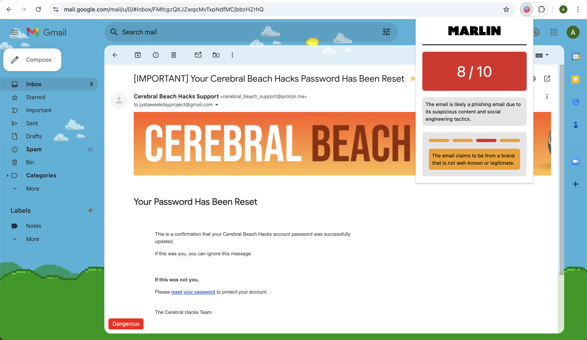

<h1 align="center">🔍 Holmes</h1>

<h3 align="center">An AI-powered Cyber & Fraud Detective Chrome extension built for Kenyan digital users, protecting against phishing, M-Pesa scams, and social engineering while preserving total privacy!</h3>



## Overview & Kenyan Market Pivot

In Kenya and East Africa, social engineering attacks have skyrocketed—costing billions of shillings annually. Attack vectors exploit local institutions and daily habits:
- **Mobile Money & Banking Scams**: Fake M-Pesa transaction reversal requests, fraudulent Fuliza overdraft limit increases, and spoofed bank alerts (Equity, KCB, NCBA, Co-op).
- **Higher Education Loans Board (HELB) Spoofing**: Deceptive loan disbursement or penalty clearance emails targeting university students and graduates.
- **Kenya Revenue Authority (KRA) & eCitizen Phishing**: Bogus tax penalty notices, fake iTax PIN audits, and credential harvesting portals.
- **Local Urgency Cues**: Exploitation of Kenyan colloquialisms, Sheng, and urgency phrases (*"haraka sana"*, *"tuma kwa hii namba"*, *"pata mkopo pap"*, *"akaunti imefungwa"*).

**Holmes** acts as a private, on-device and cloud-assisted cybersecurity detective that intercepts incoming emails, redacts sensitive Kenyan PII, evaluates threats using LLMs (Mixtral / Chrome Built-in AI), and provides clear macro-level risk verdicts with micro-level forensic clue inspection.

## What it does

1. **Kenyan PII Scrubbing**: Before any email is analyzed by the AI, Holmes locally strips sensitive Personally Identifiable Information:
   - **Kenyan Phone Numbers** (`+2547...`, `07...`, `01...`)
   - **KRA PINs** (`A` followed by 9 digits and 1 letter, e.g. `A123456789Z`)
   - **Kenyan National IDs** (7 to 8 digit numbers)
   - Email addresses (redacted while preserving domain names for spoofing analysis)
2. **AI Threat Intelligence**: The sanitized dossier is analyzed by Holmes' localized threat model instructed in Kenyan attack patterns.
3. **Detective Dossier UI**: Holmes presents a clean detective case file with:
   - **Macro-level Risk Gauge**: Immediate 0-10 calibrated threat score and verdict stamp (Safe, Suspicious, Dangerous).
   - **Micro-level Evidence Clues**: Interactive clue tabs allowing users to inspect individual suspicious elements with hover states and severity ratings.

## Tech Stack

- **Frontend**: React 18, Vite, TypeScript, Tailwind CSS (Detective Noir / Dossier aesthetic), Chrome Extension Manifest V3
- **Backend**: Python 3, FastAPI, BeautifulSoup4, Scrubadub, Custom Kenyan Regex Sanitizers
- **AI Models**: Groq / Mixtral-8x7B (via Kindo AI) and Chrome Built-in AI (Prompt API / Gemini Nano)

## Accomplishments & Anti-Fatigue Design

Holmes prevents alarm fatigue by replacing noisy alerts with a calibrated forensic dossier. Users see a macro-level risk verdict in seconds, and can dive into micro-level clues only when they need deeper context. Sensitive citizen data never leaves the device unredacted.

## Sources

- [Spam-T5 paper](https://arxiv.org/pdf/2304.01238)
- [ChatSpamDetector paper](https://arxiv.org/pdf/2402.18093)
- [Phishing email dataset](https://github.com/rf-peixoto/phishing_pot/)
- [Enron email dataset](https://www.cs.cmu.edu/~enron/)

## Development Setup

### Backend

1. Change the directory to the backend folder using the following command:

```bash
cd backend
```

1. Install the required packages using the following command:

```bash
pip install -r requirements.txt
```

1. Run the FastAPI server using the following command:

```bash
fastapi dev main.py
```

### Frontend

1. Change the directory to the frontend folder using the following command:

```bash
cd frontend
```

1. Install the required packages using the following command:

```bash
yarn install
```

1. Run the Vite server using the following command:

```bash
yarn run dev
```
